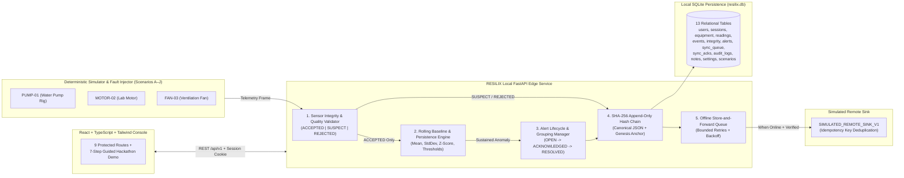

# RESILIX — Secure Predictive Infrastructure Resilience System
**Seva First Innovation Challenge 2026 | Track: Surakshit Bharat — Security & Resilience**  
*Tagline: Detect early. Operate offline. Recover securely.*

---

## 1. Project Overview
**RESILIX** is an affordable, security-aware, local-first monitoring and alerting prototype designed for small motors, centrifugal water pumps, ventilation fans, and similar essential facility infrastructure.

The prototype demonstrates how an edge-deployed monitoring service can:
- Ingest timestamped equipment telemetry (`temperature` in °C, `vibration` in mm/s RMS, and optional `current` in Amperes).
-Quarantine suspicious, missing, stale, out-of-range, replayed, and cross-sensor inconsistent readings **before** they can corrupt rolling baseline analytics (`ACCEPTED`, `SUSPECT`, `REJECTED`).
- Detect abnormal operating patterns using transparent, explainable threshold and rolling-baseline deviation logic with configurable persistence windows.
- Record events locally in an append-only **SHA-256 hash chain** anchored at Genesis (`0000...0000`).
- Continue local monitoring and event queueing during network outages and deterministically synchronize queued events with idempotency guarantees once connectivity returns.
- Enforce role-based access control (`admin` vs `operator`), memory-hard password hashing (`Scrypt` / `Argon2` compatible), server-side session tokens, brute-force login rate limiting, and audit logging.

> **Critical Truthfulness & Safety Notice**  
> 1. All telemetry, anomalies, and fault scenarios in this software prototype are generated by a deterministic simulation engine representing a laboratory motor/pump test rig (`SIMULATED`). They are **never** represented as real physical hardware measurements.  
> 2. Evaluation metrics (Precision, Recall, F1) are calculated strictly over labelled synthetic simulation runs, not field failures.  
> 3. RESILIX is a monitoring and decision-support prototype, **not** an autonomous safety controller. It never switches pumps or controls physical actuators.

---

## 2. Problem Statement & Proposed Solution
### Problem Statement
Small municipal water pumps, rural booster stations, clinic ventilation fans, and workshop motors frequently operate in environments with intermittent internet connectivity and tight maintenance budgets. Cloud-only IoT dashboards fail silently when connectivity drops, and naive threshold monitors suffer from false alarms caused by loose sensor wires (`0.0` substitutions), frozen polling loops (stale timestamps), or single-sample spikes.

### Proposed Solution
RESILIX decouples **pre-analytics sensor validation** from **equipment anomaly detection** and pairs both with an **offline-first store-and-forward SQLite ledger**:
1. **Pre-Analytics Quarantine**: Incoming frames are validated for sequence continuity, timestamp freshness, missing channels, physical plausibility bounds, and cross-sensor consistency (`ACCEPTED` vs `SUSPECT` vs `REJECTED`). Only `ACCEPTED` readings update rolling baseline statistics.
2. **Explainable Anomaly Engine**: Evaluates rolling mean/standard deviation and configured warning/critical thresholds over a per-device persistence window (`persistence_window_count`). Every alert states the exact rule that fired, observed value, threshold/baseline reference, persistence count, and recommended inspection action.
3. **Cryptographic Event Integrity**: Every event is canonically serialized and linked into a local SHA-256 hash chain (`previous_hash | canonical_payload`).
4. **Idempotent Store-and-Forward Sync**: Events are queued locally in SQLite (`sync_queue_items`) while offline and flushed in deterministic FIFO order using stable idempotency keys (`IDEMP-{event_id}-{hash}`) upon reconnection.

---

## 3. Architecture Diagram (Mermaid)


---

## 4. Technology Stack
- **Backend**: Python 3.11+, FastAPI, Pydantic (strict schema validation), SQLite3 (transactional relational persistence with WAL & foreign keys), NumPy (rolling baseline statistics), Cryptography (`Scrypt` memory-hard KDF & `SHA-256` hash chaining), Uvicorn.
- **Frontend**: React 18, TypeScript, Vite, Tailwind CSS, Recharts (time-series & severity charts), Lucide Icons.
- **Automated Testing**: Python `unittest` + FastAPI `TestClient` (`httpx`) covering 11 comprehensive unit, security, integrity, offline-sync, and end-to-end API integration test suites.

---

## 5. Project Structure
```text
resilix/
├── README.md
├── .gitignore
├── .env.example
├── requirements.txt
├── package.json
├── start_resilix.sh
├── start_resilix.bat
├── docs/
│   └── ARCHITECTURE.md
├── backend/
│   ├── run_server.py
│   ├── run_tests.py
│   ├── sitecustomize.py
│   ├── app/
│   │   ├── main.py
│   │   ├── config.py
│   │   ├── database.py
│   │   ├── models/
│   │   │   └── schema.py
│   │   ├── schemas/
│   │   │   └── api_schemas.py
│   │   ├── security/
│   │   │   └── auth.py
│   │   ├── services/
│   │   │   ├── integrity.py
│   │   │   ├── telemetry_processor.py
│   │   │   ├── sync_service.py
│   │   │   ├── analytics_service.py
│   │   │   ├── settings_service.py
│   │   │   └── seed_service.py
│   │   ├── simulator/
│   │   │   └── engine.py
│   │   └── api/
│   │       └── routes.py
│   └── tests/
│       └── test_resilix.py
└── frontend/
    ├── package.json
    ├── tsconfig.json
    ├── vite.config.ts
    ├── tailwind.config.js
    ├── index.html
    ├── scripts/
    │   └── build_static.mjs
    └── src/
        ├── main.tsx
        ├── App.tsx
        ├── types/
        │   └── index.ts
        ├── services/
        │   └── api.ts
        ├── utils/
        │   └── formatters.ts
        ├── pages/
        │   └── index.ts
        └── styles/
            └── index.css
```

---

## 6. Installation & Startup Instructions

### Linux / macOS
```bash
# 1. Backend setup & startup
cd resilix/backend
python3 -m pip install -r ../requirements.txt   # if not already installed
python3 -m uvicorn app.main:app --reload --host 127.0.0.1 --port 8000
# (Or run: python3 run_server.py)

# 2. Frontend setup & startup (in a second terminal)
cd resilix/frontend
npm install
npm run dev
```

### Windows (PowerShell / Command Prompt)
```powershell
:: 1. Backend setup & startup
cd resilix\backend
python -m pip install -r ..\requirements.txt
python -m uvicorn app.main:app --reload --host 127.0.0.1 --port 8000

:: 2. Frontend setup & startup
cd resilix\frontend
npm install
npm run dev
```

### API Documentation Location
When the backend is running on `http://127.0.0.1:8000`:
- **Swagger UI (OpenAPI)**: `http://127.0.0.1:8000/docs`
- **ReDoc**: `http://127.0.0.1:8000/redoc`
- **OpenAPI JSON Schema**: `http://127.0.0.1:8000/openapi.json`

---

## 7. Seeded Demonstration Credentials
Only cryptographic password hashes (`scrypt$16384$8$1$...`) are stored in the SQLite database. Public self-registration is disabled by design.

| Role | Username | Password | Permissions |
| :--- | :--- | :--- | :--- |
| **Administrator** | `admin` | `ResilixAdmin!2026` | Full access: register/edit/disable equipment, modify system & anomaly thresholds, reset demo dataset, acknowledge & resolve alerts, run scenarios & sync. |
| **Operator** | `operator` | `ResilixOper!2026` | Operational access: view telemetry & analytics, acknowledge & resolve alerts, add maintenance notes, run simulation scenarios & sync. Blocked (`403 Forbidden`) from modifying system thresholds or registering equipment. |

---

## 8. Database Initialization & Demo Reset
- On startup, `app.main:on_startup` automatically initializes all 13 SQLite tables and idempotently seeds the 2 demo users, 3 laboratory equipment rigs (`PUMP-01`, `MOTOR-02`, `FAN-03`), runtime settings, initial baseline readings, and the Genesis SHA-256 event chain link (`EVT-00001-GENESIS`) without deleting existing user records.
- To reset the demonstration dataset to a clean baseline state at any time:
  - Click **Reset Demo Data** in the top bar (requires explicit confirmation dialog), **or**
  - Send `POST /api/v1/analytics/reset-demo` as `admin`.

---

## 9. Available Fault-Injection Scenarios (A–J)
| Code | Scenario Name | Expected Behavior & Visible Outcome |
| :--- | :--- | :--- |
| `A_NORMAL` | **A. Normal Operation** | Readings stay within baseline (`~36–48°C`, `~1.1–2.8 mm/s RMS`); status remains `HEALTHY` with zero critical alerts. |
| `B_ELEVATED_VIBRATION` | **B. Elevated Vibration** | Injects sustained vibration above critical threshold across the persistence window; creates explainable `VIBRATION_CRITICAL_THRESHOLD` event & alert. |
| `C_RISING_TEMPERATURE` | **C. Rising Temperature** | Injects sustained temperature rise above critical bounds; triggers `TEMPERATURE_CRITICAL_THRESHOLD` alert. |
| `D_MISSING_SENSOR` | **D. Missing Sensor Field** | Omits the `vibration` sensor value; marks reading `SUSPECT` and logs `MISSING_SENSOR_FIELD` event rather than substituting `0.0`. |
| `E_STALE_SENSOR` | **E. Stale Sensor Timestamp** | Sends a timestamp older than `stale_data_timeout_seconds`; marks reading `SUSPECT` and logs `STALE_SENSOR_DATA`. |
| `F_IMPLAUSIBLE_READING` | **F. Implausible Reading** | Sends `-9.5 mm/s RMS` vibration & `195°C` temperature; quarantines reading as `REJECTED` so rolling baseline statistics are uncorrupted. |
| `G_INCONSISTENT_READING` | **G. Inconsistent Signals** | Sends high vibration (`6.4 mm/s RMS`) while motor current is near-zero (`0.20 A`); flags `INCONSISTENT_CROSS_SENSOR_SIGNALS` (`SUSPECT`). |
| `H_NETWORK_OUTAGE` | **H. Network Outage** | Disables remote synchronization link (`OFFLINE`) and generates local anomaly events; local SQLite queue (`PENDING`) increases while monitoring continues. |
| `I_NETWORK_RECOVERY` | **I. Network Recovery** | Restores synchronization link (`ONLINE`) and flushes queued events in FIFO order using idempotency keys without creating duplicates. |
| `J_SENSOR_RECOVERY` | **J. Sensor Recovery** | Restores valid telemetry after a sensor fault, transitions `sensor_health_status` back to `OK`, and logs `SENSOR_HEALTH_RECOVERED`. |

---

## 10. Guided 7-Step Live Hackathon Demonstration Sequence
1. **Step 1 — Normal Operation**: Sign in as `admin`, view `PUMP-01` healthy telemetry and rolling baselines on `/dashboard`.
2. **Step 2 — Fault Detection**: Trigger Scenario `B_ELEVATED_VIBRATION` on `PUMP-01`; inspect the explainable rule, persistence count, deviation score, and recommended action on `/alerts`.
3. **Step 3 — Sensor Integrity**: Trigger Scenario `D_MISSING_SENSOR` on `MOTOR-02`; observe `MISSING_SENSOR` quarantine (`SUSPECT`) separate from equipment anomalies.
4. **Step 4 — Offline Resilience**: Open `/events` and trigger Scenario `H_NETWORK_OUTAGE` (or click *Simulate Network Outage*); generate additional events and watch the local `PENDING` queue grow while offline.
5. **Step 5 — Secure Recovery**: Trigger Scenario `I_NETWORK_RECOVERY` (or click *Restore Network Link* + *Synchronize Queue Now*); verify all queued events transition to `SYNCED` and repeated sync runs produce `0` duplicates.
6. **Step 6 — Integrity Verification**: Open `/security` and click *Run Full Chain Verification*; verify `VERIFIED_INTACT` across all SHA-256 links (and optionally test *Simulate Tamper Test* to see `INTEGRITY_COMPROMISED` detection).
7. **Step 7 — Analytics & Export**: Open `/analytics` to inspect the synthetic confusion matrix (Precision, Recall, F1), scenario execution log, and click *Export CSV Report*.

---

## 11. Automated Testing & Build Commands
```bash
# Run the complete backend unit & API integration test suite (11 test suites)
cd resilix/backend
python3 run_tests.py

# Run frontend TypeScript AST verification & static production build
cd resilix/frontend
npm run build
```

---

## 12. Security Considerations & Current Limitations
- **Cryptographic Hash Chain Scope**: The local SHA-256 hash chain (`event_integrity_records`) detects accidental corruption, single-row tampering, or out-of-order deletion. However, a hash chain stored solely in a local SQLite file cannot prevent a privileged attacker with root/filesystem write access from rewriting the entire database and recomputing all hashes from Genesis. Production edge deployments should anchor periodic chain heads to a hardware security module (TPM 2.0 / ATECC608) or a remote append-only transparency log.
- **Transport & Storage**: The prototype runs over local HTTP (`127.0.0.1`) with unencrypted SQLite storage for zero-dependency laptop evaluation. Production deployment requires TLS 1.3 (HTTPS), `Secure` cookies, managed secret injection (KMS/Vault), and full-disk encryption (LUKS/BitLocker).
- **Offline Edge Requirement**: Local offline resilience requires the local FastAPI edge process and SQLite storage to remain powered on; a browser tab alone cannot ingest physical telemetry if the edge host machine is shut down.

---

## 13. Future ESP32 & Physical Sensor Integration Plan
RESILIX is designed so an ESP32-class edge node can post directly to `POST /api/v1/equipment/ingest`:
- **Hardware Bill of Materials (Future Phase)**: ESP32-WROOM-32D, ADXL345 / MPU6050 digital accelerometer (vibration RMS calculation over 1 kHz sample window), DS18B20 / PT100 RTD temperature probe, SCT-013 non-invasive current transformer, and DS3231 battery-backed RTC module.
- **Device Authentication**: Provision per-device HMAC-SHA256 or mTLS client certificates in the `integrity_signature` field of `TelemetryIngestRequest`, setting `simulation_mode="PHYSICAL_ESP32"`.
